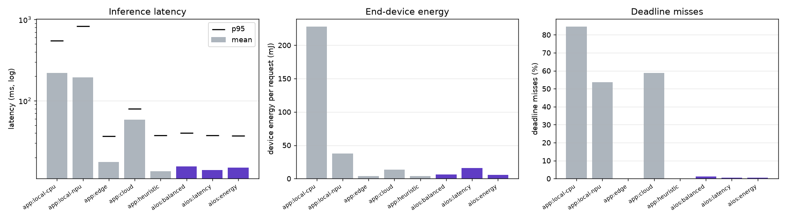
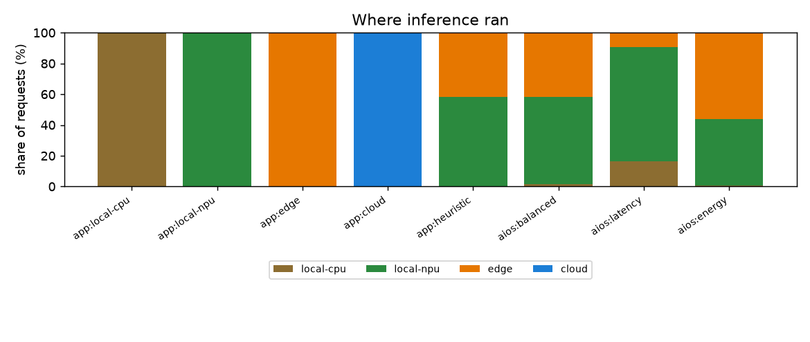
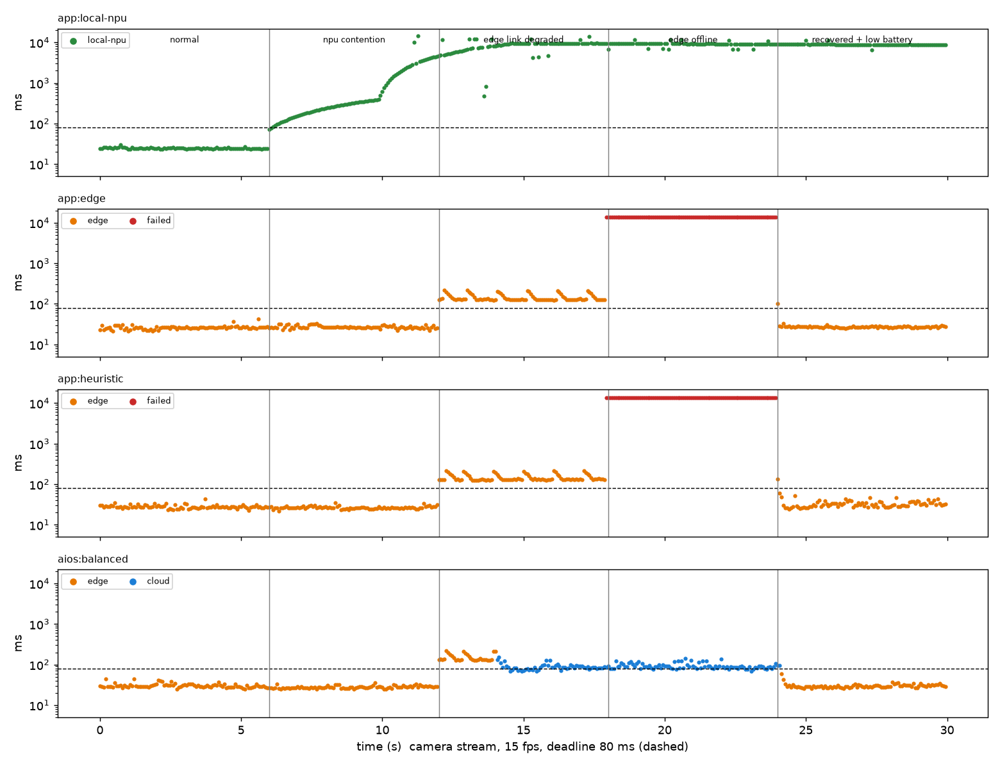
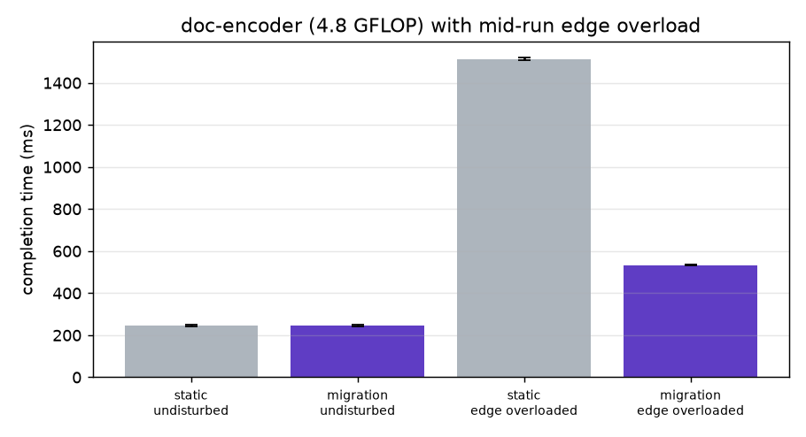
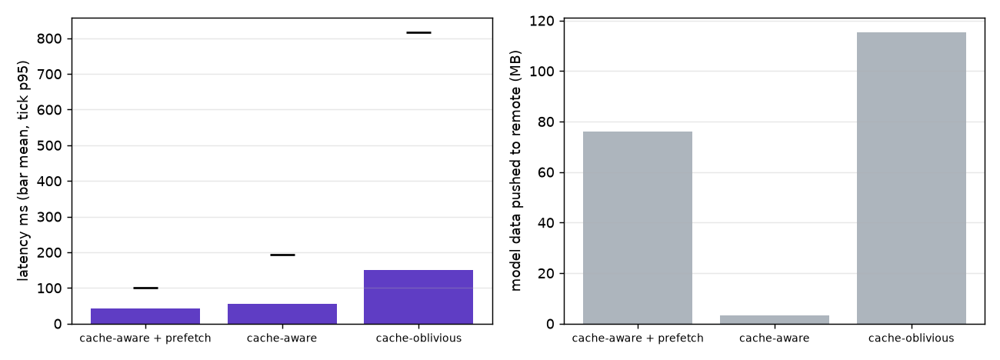

# AIOS evaluation results

Run started 2026-10-06 17:32:32, duration 423.4 s, full mode, seed 7, 12 host CPUs, Python 3.12.14.

Host 1-minute load average 9.0 — the host was shared with other heavy workloads during this run, which slows the real numpy compute inside every emulated device (most visible on the cloud profile, whose nominal speed is above what this host delivers).

All placements go through the same daemon and execution path; application-managed baselines pin the target (`pin=`) the way an application would hard-code a device, AIOS-managed runs let the OS layer decide. Devices are emulated on one host: every inference really executes (numpy), compute time is shaped to the device profile, links are shaped for RTT and shared bandwidth, and thermal state evolves with utilization. Energy is estimated from the device power model since RAPL counters are not readable without root.

## Testbed

| target | tier | GFLOPS | slots | trusted | memory MB | cache MB | active W | RTT ms | Mbit/s |
|---|---|---|---|---|---|---|---|---|---|
| local-cpu | device | 2.5 | 2 | True | 512 | 160 | 4.0 | - | - |
| local-npu | device | 12.0 | 1 | True | 96 | 48 | 1.6 | - | - |
| edge | edge | 30.0 | 4 | True | 4096 | 1024 | 35.0 | 6 | 200 |
| cloud | cloud | 150.0 | 16 | False | 65536 | 8192 | 250.0 | 45 | 60 |

## E1  Latency, throughput, utilization, energy under a steady mixed workload

Open-loop Poisson load: sensor-mlp 12/s (15 ms deadline), kws-cnn 6/s (30 ms), vision-cnn 12/s (80 ms), batch-encoder 2/s (300 ms). Warm-up excluded.

| policy | mean ms | p50 | p95 | p99 | miss % | req/s | device mJ/req | system mJ/req | failed | target utilization | host CPU % |
|---|---|---|---|---|---|---|---|---|---|---|---|
| app:local-cpu | 221.0 | 196.0 | 548.0 | 685.6 | 84.5 | 30.5 | 227.89 | 227.9 | 0 | local-cpu 87% | 99.9 |
| app:local-npu | 194.3 | 53.1 | 825.4 | 940.0 | 53.6 | 29.4 | 37.87 | 37.9 | 0 | local-npu 70% | 98.5 |
| app:edge | 17.5 | 10.3 | 36.7 | 39.3 | 0.0 | 31.0 | 3.86 | 289.7 | 0 | edge 6% | 59.9 |
| app:cloud | 58.5 | 52.8 | 79.3 | 85.3 | 58.8 | 30.9 | 13.22 | 1663.3 | 0 | cloud 2% | 67.6 |
| app:heuristic | 13.5 | 3.2 | 37.2 | 44.5 | 0.0 | 31.0 | 4.07 | 267.9 | 0 | local-npu 2%, edge 6% | 68.1 |
| aios:balanced | 15.5 | 4.9 | 40.2 | 53.0 | 1.1 | 31.0 | 6.38 | 248.5 | 0 | local-npu 7%, edge 5% | 66.1 |
| aios:latency | 13.9 | 4.1 | 37.4 | 55.9 | 0.4 | 31.0 | 15.93 | 77.2 | 0 | local-npu 27%, edge 1% | 69.1 |
| aios:energy | 15.0 | 10.1 | 36.9 | 52.4 | 0.4 | 31.0 | 5.67 | 238.8 | 0 | local-npu 5%, edge 5% | 43.6 |

## E2  Adaptation to changing system conditions

Camera stream (vision-cnn, 15 fps, session-sticky, 80 ms deadline) plus sensor-mlp at 10/s. Every 6 s the system changes: normal; npu contention; edge link degraded; edge offline; recovered + low battery.

| policy | normal (mean ms / miss) | npu contention (mean ms / miss) | edge link degraded (mean ms / miss) | edge offline (mean ms / miss) | recovered + low battery (mean ms / miss) | overall mean ms | overall miss % | failed | device mJ/req |
|---|---|---|---|---|---|---|---|---|---|
| app:local-npu | 17 / 5% | 1026 / 99% | 8259 / 100% | 9177 / 100% | 8777 / 100% | 5472.7 | 80.9 | 0 | 73.95 |
| app:edge | 19 / 0% | 20 / 0% | 125 / 100% | 64 / 100% | 20 / 1% | 45.4 | 39.4 | 145 | 18.50 |
| app:heuristic | 17 / 0% | 17 / 0% | 89 / 60% | 2 / 62% | 20 / 1% | 32.7 | 24.2 | 91 | 15.36 |
| aios:balanced | 19 / 0% | 18 / 0% | 67 / 50% | 58 / 51% | 19 / 1% | 36.0 | 20.1 | 0 | 11.08 |

## E3  Inference migration and its overhead

doc-encoder (16 layers, 4.8 GFLOP, 768 KiB activation state). In disturbed trials the edge is driven to 90% background load 60 ms after submission.

| mode | edge overloaded | trials | mean ms | std | migrations | checkpoint ms | state KiB | resume transfer ms | paths |
|---|---|---|---|---|---|---|---|---|---|
| migration | yes | 6 | 532.6 | 2.1 | 6 | 113.7 | 768 | 0.0 | edge > local-npu |
| migration | no | 6 | 246.6 | 3.0 | 0 | - | - | - | edge |
| no-migration | yes | 6 | 1513.8 | 5.5 | 0 | - | - | - | edge |
| no-migration | no | 6 | 245.1 | 4.0 | 0 | - | - | - | edge |

Checkpoint time runs from the preempt signal to the activation arriving at the daemon and includes finishing the layer in progress on the overloaded node. Resume transfer is the network time of the first segment on the new target.

## E4  Model availability and caching

Cold start, five models with skewed popularity, including two 36 MB encoders that do not fit the NPU cache together.

| mode | mean ms | p95 | miss % | model loads | MB pushed | requests that waited for a model | total model wait ms | prefetches |
|---|---|---|---|---|---|---|---|---|
| cache-aware + prefetch | 42.9 | 100.9 | 3.2 | 16 | 76.1 | 10 | 594 | 6 |
| cache-aware | 54.5 | 193.6 | 2.9 | 17 | 3.1 | 17 | 1045 | 0 |
| cache-oblivious | 150.1 | 816.0 | 9.3 | 11 | 115.2 | 11 | 9390 | 0 |

## E5  Cost of the OS-level abstraction

| path | median ms | p95 ms |
|---|---|---|
| aios pinned | 1.010 | 1.354 |
| aios scheduled | 1.230 | 1.562 |
| direct | 0.047 | 0.067 |

IPC and request handling add 0.963 ms over calling the executor in-process; letting AIOS choose the target adds a further 0.220 ms.

| model | placement decision median us | p95 us |
|---|---|---|
| batch-encoder:1 | 568 | 886 |
| doc-encoder:1 | 599 | 786 |
| kws-cnn:1 | 454 | 613 |
| sensor-mlp:1 | 290 | 416 |
| vision-cnn:1 | 473 | 582 |

## Application-side resource-management code

`examples/app_managed.py` (application probes devices, ships models, picks a target and falls back on failure) has 91 non-blank lines; `examples/app_aios.py` doing the same job through AIOS has 15.
